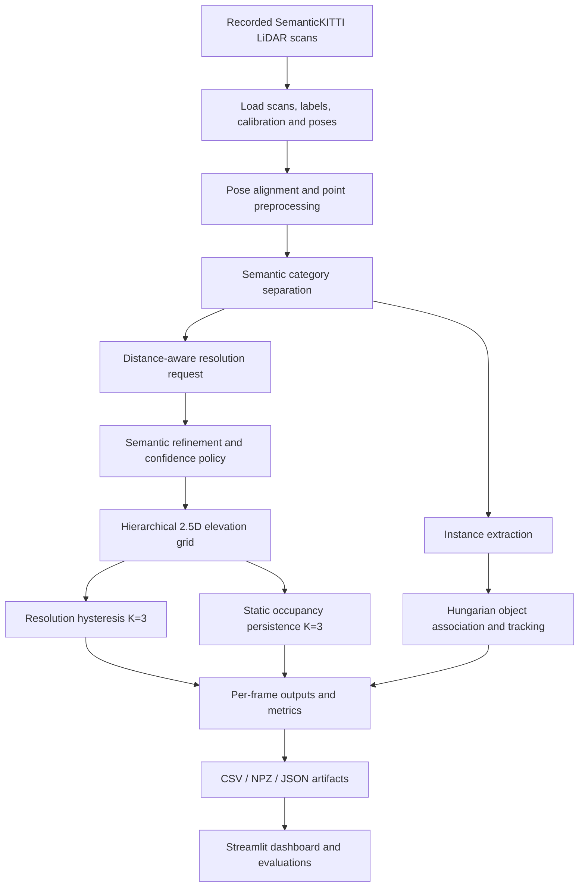

# Adaptive 2.5D LiDAR Mapping

**Adaptive-resolution, semantic-aware 2.5D LiDAR mapping with temporal stabilization and multi-object tracking.**  
**Smart India Hackathon 2026 | Problem Statement: SIH26053**

[](https://ashiwany-2-5d-lidar-mapping.streamlit.app/)
[](https://github.com/Ashiwany25/Adaptive-2.5D-LiDAR-Mapping)
[](https://www.python.org/)
[](http://www.semantic-kitti.org/)

> **Demo scope:** This project processes **recorded SemanticKITTI LiDAR scans**, not a live LiDAR sensor feed. The public dashboard presents precomputed outputs. Semantic labels come from the dataset's ground truth; the project does **not** claim to train or deploy a semantic segmentation model.

## Live Demo and Source

- **Interactive dashboard:** https://ashiwany-2-5d-lidar-mapping.streamlit.app/
- **GitHub repository:** https://github.com/Ashiwany25/Adaptive-2.5D-LiDAR-Mapping
- **Dataset:** http://www.semantic-kitti.org/

The dashboard provides frame-by-frame inspection of static and object maps, adaptive cell resolutions, temporal confirmation, tracked objects, and evaluation comparisons. It is designed as an **offline replay and analysis dashboard**.

## 1. Problem Statement

Conventional uniform-resolution LiDAR occupancy or elevation maps face a trade-off: fine grids preserve more local detail but increase cell count and processing costs, while coarse grids are more economical but can lose thin or safety-relevant structures. Sensor noise, intermittent observations, and moving objects can also destabilize maps over time.

This project explores a **variable-resolution 2.5D mapping pipeline** that combines distance-aware resolution selection, semantic refinement, temporal persistence, and object tracking to address those challenges. The project was developed for **Smart India Hackathon 2026, problem SIH26053**, with an ADAS/autonomous-driving research use case.

## 2. Main Features

| Component | Implementation |
|---|---|
| Adaptive spatial resolution | 0.25 m near range, 0.5 m middle range, 1.0 m far range |
| Semantic-aware refinement | Configured safety-relevant classes can request finer mapping cells |
| Confidence gating | Configurable threshold (0.80) in controlled tests; **not** a learned semantic confidence estimator |
| Resolution hysteresis | Three-frame (`K=3`) persistence before coarsening |
| Occupancy persistence | Three-frame (`K=3`) confirmation for observed static cells |
| 2.5D elevation map | Per-cell height statistics: minimum, maximum, and mean elevation |
| Dynamic separation | Separates static, movable/object, and moving semantic categories |
| Object association | Instance extraction and distance-gated Hungarian assignment |
| Temporal tracking | Track IDs, centroid history, estimated velocity, and association status |
| Evaluation | Mapping integrity, elevation error, object preservation, boundary proxy, timing, and distance-based analysis |
| Interactive visualization | Plotly visualizations and Streamlit dashboard |

### Resolution policy

| Sensor-relative distance | Default grid resolution |
|---|---:|
| Near: < 20 m | 0.25 m |
| Middle: 20–< 40 m | 0.5 m |
| Far: ≥ 40 m | 1.0 m |

These are **default distance bands**; semantic override and temporal hysteresis can change the resolution requested for individual regions. The grid uses a hierarchical, root-aligned representation to avoid overlapping leaf cells.

## 3. System Architecture



### Processing overview

1. **Load data:** Read `.bin` point clouds and corresponding `.label` annotations from SemanticKITTI.
2. **Align frames:** Use calibration and pose information to express scans in a consistent reference frame.
3. **Separate semantic categories:** Identify static, object/movable, and moving-labelled points using dataset annotations.
4. **Build maps:** Request grid resolutions by distance and semantic policy; aggregate per-cell elevation statistics.
5. **Stabilize across time:** Apply `K=3` resolution hysteresis and static occupancy confirmation.
6. **Track objects:** Extract annotated object instances, match detections using a gated Hungarian assignment, and estimate motion from centroid changes.
7. **Evaluate and visualize:** Save frame-level outputs and compare mapping methods through offline analysis and a Streamlit dashboard.

## 4. Dataset and Experimental Scope

The project uses **SemanticKITTI**, a publicly available LiDAR dataset based on KITTI odometry sequences, including per-point semantic and instance annotations.

For the local demonstration and integrated pipeline validation, the project processes **10 consecutive scans from sequence 00** (`000000`–`000009`) with associated labels and pose/calibration data. At an assumed 10 Hz scan rate, these represent approximately **one second of recorded data**. They must not be described as a lengthy driving trial or a live sensor stream.

**Important distinctions:**

- Semantic annotations are **dataset ground truth**, not predictions from a model trained in this repository.
- A configurable confidence threshold is used for controlled policy evaluation; it is **not a calibrated probability output from a deployed perception network**.
- Object associations are based on the available labelled instances and centroid tracking; they do **not** constitute end-to-end live object detection.
- Raw SemanticKITTI scans are **not included in this repository**. Obtain the dataset from the official source and comply with its terms.

## 5. Repository Structure

```text
Adaptive-2.5D-LiDAR-Mapping/
├── app/
│   └── streamlit_app.py              # Interactive offline dashboard
├── benchmarks/                       # Benchmark scripts and/or compact results
├── configs/
│   └── mapping.yaml                  # Mapping, semantic, temporal and tracking settings
├── data/
│   ├── raw/                          # Local dataset only; excluded from Git
│   └── processed/
│       ├── real_pipeline_validation/ # Per-frame CSV/NPZ outputs and metadata
│       ├── comparison/               # Benchmark comparison CSVs
│       └── visualizations/           # Local HTML exports; excluded from Git
├── demo_video/                       # Optional local recordings; not needed for app
├── scripts/
│   ├── run_real_pipeline.py
│   ├── evaluate_real_pipeline.py
│   ├── visualize_real_pipeline.py
│   ├── create_lidar_animation.py
│   └── test_deployment_package.py
├── src/
│   └── lidar_mapping/
│       ├── preprocessing/
│       ├── mapping/
│       ├── semantic/
│       ├── temporal/
│       ├── tracking/
│       ├── visualization/
│       ├── utils/
│       └── pipeline.py
├── tests/
├── pyproject.toml
├── requirements.txt
└── README.md
```

*The tree illustrates the project layout. Locally generated or ignored folders may not appear in the GitHub repository.*

## 6. Installation and Local Usage

### Requirements

- Python **3.10 or newer** (Python 3.11 is a practical choice)
- Git
- Dataset files only if regenerating results from raw LiDAR scans

The deployed dashboard uses NumPy, pandas, SciPy, Plotly, PyYAML, and Streamlit. Open3D is optional for workflows that require it and is not necessary for the precomputed-data dashboard.

### Clone and install

```bash
git clone https://github.com/Ashiwany25/Adaptive-2.5D-LiDAR-Mapping.git
cd Adaptive-2.5D-LiDAR-Mapping
python3 -m venv .venv
source .venv/bin/activate
python -m pip install --upgrade pip
python -m pip install -r requirements.txt
```

### Launch the dashboard

```bash
streamlit run app/streamlit_app.py
```

Open the local address printed by Streamlit, commonly `http://localhost:8501`.

The dashboard reads **precomputed outputs** under `data/processed/`. You can explore the published results without downloading the full SemanticKITTI dataset.

### Regenerate the local pipeline outputs

1. Download the appropriate SemanticKITTI sequence files from the official dataset website.
2. Place scans, labels, calibration and poses in the expected layout:

```text
data/raw/SemanticKITTI/sequences/00/
├── velodyne/
│   ├── 000000.bin
│   └── ...
├── labels/
│   ├── 000000.label
│   └── ...
├── calib.txt
└── poses.txt
```

3. Review the settings in `configs/mapping.yaml`.
4. Run the integrated pipeline and evaluation scripts:

```bash
python scripts/run_real_pipeline.py
python scripts/evaluate_real_pipeline.py
python scripts/visualize_real_pipeline.py
```

The scripts require the expected dataset and project dependencies. Regeneration is separate from using the hosted dashboard.

## 7. Configuration

The principal parameters are defined in `configs/mapping.yaml`:

```yaml
mapping:
  x_min: -50
  x_max: 50
  y_min: -50
  y_max: 50
  root_resolution: 1.0
  minimum_resolution: 0.25
  near_distance: 20
  mid_distance: 40
  near_resolution: 0.25
  mid_resolution: 0.5
  far_resolution: 1.0

semantic:
  confidence_threshold: 0.80
  critical_classes: [10, 11, 13, 15, 18, 20, 30, 31, 32, 80, 81, 252, 253, 254, 255, 256, 257, 258, 259]

temporal:
  occupancy_persistence_frames: 3
  resolution_coarsening_frames: 3
  occupancy_deactivation_frames: 2

tracking:
  maximum_matching_distance: 3.0
  maximum_missing_frames: 2
  assumed_frame_interval_seconds: 0.1
  minimum_instance_points: 5
```

**Note:** The `critical_classes` values are SemanticKITTI label IDs used by the project policy. This list is a configured heuristic, not a learned risk score.

## 8. Evaluation Methodology and Results

The project compares adaptive mapping against fixed-resolution baselines and evaluates temporal and object-level behavior.

### Elevation reconstruction comparison

The following results come from the project's existing `elevation_accuracy_summary.csv` comparison artifact:

| Method | Average RMSE (m) ↓ | Average MAE (m) ↓ | Average occupied cells |
|---|---:|---:|---:|
| Adaptive stabilized | **0.3382** | **0.1820** | **10,458.6** |
| Uniform 0.25 m | 0.3187 | 0.1707 | 13,550.9 |
| Uniform 0.5 m | 0.3533 | 0.1985 | 5,764.4 |

**Interpretation:** In this evaluated sample, the adaptive method uses fewer occupied cells than uniform 0.25 m mapping, with somewhat higher elevation reconstruction error. It is more accurate than the 0.5 m uniform baseline in these reported elevation metrics, but uses more occupied cells. **No single method dominates every metric.**

These are **in-sample elevation reconstruction errors**, not proof of obstacle detection accuracy, collision avoidance performance, or road safety improvement.

### Additional evaluation dimensions

- **Spatial integrity:** Check nonoverlapping hierarchical leaves and map coverage consistency.
- **Temporal stabilization:** Compare observed and confirmed static cells under the `K=3` policy.
- **Object-level preservation:** Assess how labelled objects are represented at different ranges.
- **Boundary-sensitive proxy:** Use a convex-hull-based geometric proxy; do **not** interpret it as ground-truth boundary recall.
- **Distance-stratified analysis:** Evaluate near, middle, and far-range behavior separately.
- **Processing time:** Measure pipeline processing components; reported timings exclude raw file loading, semantic inference, and pose estimation unless explicitly stated otherwise.

For further metrics and plots, consult the generated evaluation artifacts and the [live dashboard](https://ashiwany-2-5d-lidar-mapping.streamlit.app/). Results should always be interpreted in the context of the dataset subset and evaluation protocol.

## 9. Streamlit Dashboard

The [live dashboard](https://ashiwany-2-5d-lidar-mapping.streamlit.app/) supports:

- Selection of recorded SemanticKITTI frames `000000`–`000009`.
- Static and object-layer 2.5D mapping views.
- Adaptive cell-resolution colors and cell-level inspection.
- Temporal observed-versus-confirmed occupancy visualization.
- Tracked object information and trajectory inspection.
- Frame-level processing and cell-count summaries.
- Comparison charts for adaptive and uniform-resolution baselines.

**Visualization convention:** Resolution colors identify cell size, **not** a hazard or safety score.

## 10. Design Decisions and Trade-offs

| Decision | Reason | Limitation / alternative |
|---|---|---|
| Hierarchical adaptive grid | Concentrate spatial detail where needed | More complex than a uniform array; alternatives include quadtrees or sparse voxel grids |
| 2.5D elevation statistics | Compact representation for road-scene analysis | Cannot represent multiple independent vertical surfaces at the same planar cell as a full 3D map can |
| Semantic override | Preserve detail for configured object categories | Depends on label quality and selected class policy |
| `K=3` persistence | Reduce one-frame map churn | Adds confirmation latency; tune for different sensor rates |
| Hungarian association | Global assignment of detections to tracks under a distance gate | Does not replace a full probabilistic multi-object tracking system |
| Recorded SemanticKITTI data | Reproducible testing with real LiDAR and annotations | Not an on-vehicle real-time validation |
| Precomputed Streamlit deployment | Lightweight, reproducible public demonstration | Hosted app does not run the entire raw-data pipeline on demand |

## 11. Limitations and Future Work

### Current limitations

- Demonstrated on a limited recorded-data subset, not a comprehensive safety-validation corpus.
- No live sensor acquisition or vehicle hardware integration.
- No trained semantic segmentation or calibrated prediction confidence model in this implementation.
- Ground-truth labels and provided poses are used during offline evaluation.
- No validated real-time end-to-end latency guarantee on automotive hardware.
- 2.5D maps cannot express every multi-layer 3D geometry.
- Some boundary metrics are geometric proxies rather than exact boundary-recall measures.

### Possible next steps

1. Expand evaluation to more SemanticKITTI sequences, scenes, weather and object categories.
2. Integrate an actual semantic perception model and evaluate confidence calibration.
3. Add free-space ray tracing, occlusion handling and probabilistic occupancy updates.
4. Compare tracking against annotated trajectories and established tracking metrics.
5. Profile memory and latency on edge/automotive compute hardware.
6. Evaluate robustness to noisy labels, pose drift, dropped frames and sensor degradation.
7. Test on a live LiDAR platform after offline validation is complete.

## 12. Reproducibility and Responsible Interpretation

- Keep the dataset version, sequence IDs, frame range and configuration alongside each reported experiment.
- Compare methods under the same input scans and evaluation protocol.
- Separate map-generation runtime from data-loading and other upstream perception costs.
- Do not equate smaller maps or lower elevation RMSE with verified ADAS safety.
- Use the term **recorded-data playback** for the dashboard and animation.
- Avoid presenting ground-truth annotations as model predictions.

## 13. Technology Stack

**Language:** Python  
**Numerical processing:** NumPy, pandas, SciPy  
**Visualization:** Plotly, Streamlit  
**Configuration:** PyYAML  
**Testing / tooling:** pytest, Ruff, Git, GitHub  
**Dataset:** SemanticKITTI  
**Development environments:** VS Code, Google Colab  
**Optional 3D utilities:** Open3D

## 14. Smart India Hackathon 2026

This project was developed in the context of **SIH 2026 problem statement SIH26053**, exploring variable-resolution LiDAR mapping for ADAS/autonomous-driving research. The approach emphasizes:

- Detail preservation where it matters.
- Lower map-cell requirements relative to fine uniform grids in the evaluated comparison.
- Temporal consistency across recorded frames.
- Separation of object/moving layers from static mapping.
- Transparent, reproducible evaluation with explicit limitations.

The project is a **research and demonstration prototype**, not a certified automotive safety system.

## 15. References and Acknowledgments

- [SemanticKITTI dataset and documentation](http://www.semantic-kitti.org/)
- [KITTI Vision Benchmark Suite](https://www.cvlibs.net/datasets/kitti/)
- [Streamlit documentation](https://docs.streamlit.io/)
- [SciPy linear sum assignment (Hungarian-style assignment)](https://docs.scipy.org/doc/scipy/reference/generated/scipy.optimize.linear_sum_assignment.html)

Thanks to the SemanticKITTI and KITTI teams for making annotated LiDAR research data available. Dataset access and reuse are subject to their respective terms.

---

**Explore the project:** [Live Streamlit Dashboard](https://ashiwany-2-5d-lidar-mapping.streamlit.app/) · [GitHub Source](https://github.com/Ashiwany25/Adaptive-2.5D-LiDAR-Mapping)
